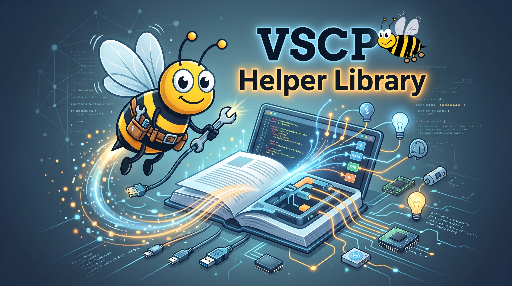

# vscp-helper-lib


 
[](https://github.com/grodansparadis/vscp-helper-lib/actions/workflows/macos.yml)
[](https://github.com/grodansparadis/vscp-helper-lib/actions/workflows/arm64.yml)
[](https://github.com/grodansparadis/vscp-helper-lib/actions/workflows/armhf.yml)

[](https://www.repostatus.org/#active)




Helper functionality for [VSCP](https://www.vscp.org), packaged as a shared library.

**Available on**: Linux, Raspberry Pi, Windows, and macOS

- Full documentation is available [here](https://docs.vscp.org/#vscphelper).
- The Python wrapper is available [here](https://github.com/grodansparadis/pyvscp).
- The Node.js wrapper is available [here](https://github.com/grodansparadis/node-vscp-helper).

## TLS connections

Use an `stcp://host:port` endpoint to connect to a TLS-enabled VSCP daemon.
The library verifies the server certificate and hostname by default. For a
private CA, configure OpenSSL's trust locations or set `SSL_CERT_FILE` or
`SSL_CERT_DIR` before starting the application.

See the [TLS connection guide](docs/tls.md) for examples, certificate setup,
client-certificate limitations, and troubleshooting.

## How to install on Linux

Download the latest Debian packages for your system from this repository's
Releases page. If you only need to run an application that uses the library,
install the runtime package. If you are developing an application, install
both the runtime and development packages; the development package includes
the header files.

```bash
sudo apt install ./libvscphelper14_14.0.0-1_amd64.deb
sudo apt install ./libvscphelper14-dev_14.0.0-1_amd64.deb
```

These are example filenames; use the package files downloaded for your system.

If `apt` reports that the local package could not be accessed by the `_apt`
user, this is a known warning for local `.deb` files. You can ignore it if
the installation succeeds. Otherwise, install the packages with `dpkg`:

```bash
sudo dpkg -i ./libvscphelper14_14.0.0-1_amd64.deb
sudo dpkg -i ./libvscphelper14-dev_14.0.0-1_amd64.deb
```

## How to install on Windows

Run the Windows installation script available on this repository's Releases
page.

## How to build on Linux

The VSCP helper library uses CMake 3.14 or later and requires the OpenSSL
development files. On Debian or Ubuntu, install them before configuring:

```bash
sudo apt-get install libssl-dev
```

```bash
git clone https://github.com/grodansparadis/vscp-helper-lib.git
cd vscp-helper-lib
cmake -S . -B build
cmake --build build
sudo cmake --build build --target install
```

Third-party code (the [VSCP main project](https://github.com/grodansparadis/vscp),
[spdlog](https://github.com/gabime/spdlog), and
[nlohmann/json](https://github.com/nlohmann/json)) is downloaded automatically
by CMake when the project is configured. No submodules or separate clones are
needed. Pinned versions are listed in
[`cmake/VscpHelperDependencies.cmake`](cmake/VscpHelperDependencies.cmake). To
use a local VSCP checkout, pass
`-DFETCHCONTENT_SOURCE_DIR_VSCP=/path/to/vscp` to CMake.

If you previously configured a Mongoose-based build, use a fresh build
directory. CMake does not remove previously downloaded sources or build
artifacts.

## How to build on Windows

### Install Visual Studio 2022 Build Tools

Download Visual Studio 2022 Build Tools from
<https://visualstudio.microsoft.com/downloads/>. In the Visual Studio
Installer, select the **Desktop development with C++** workload.

### Install CMake and Git

Install the latest version of [CMake](https://cmake.org/download/) and
[Git for Windows](https://gitforwindows.org/).

### Install vcpkg

Open a Visual Studio 2022 x64 Native Tools Command Prompt and run:

```bat
git clone https://github.com/microsoft/vcpkg.git
cd vcpkg
bootstrap-vcpkg.bat
vcpkg integrate install
vcpkg install dlfcn-win32:x64-windows
vcpkg install expat:x64-windows
vcpkg install openssl:x64-windows
vcpkg install pthreads:x64-windows
```

### Clone the repository

```bash
git clone https://github.com/grodansparadis/vscp-helper-lib.git
```

Third-party code (the VSCP main project, spdlog, and nlohmann/json) is
downloaded automatically by CMake when you configure the project.

### Build the library

```bash
cd vscp-helper-lib
cmake -S . -B build -G "Visual Studio 17 2022" -A x64 ^
-DVCPKG_TARGET_TRIPLET=x64-windows ^
-DVCPKG_ROOT=G:/vcpkg ^
-DCMAKE_TOOLCHAIN_FILE=G:/vcpkg/scripts/buildsystems/vcpkg.cmake
```

Adjust the vcpkg paths if you installed it somewhere other than `G:/vcpkg`.

Build the library in Release mode with:

```bash
cmake --build build --config Release
```

You can also build with MSBuild:

```bash
msbuild build\libvscphelper.sln /p:Configuration=Release
```

Alternatively, open `build\libvscphelper.sln` in Visual Studio 2022.

To create an installation package for Windows, run this from the build
directory:

```bash
cd build
cpack
```
